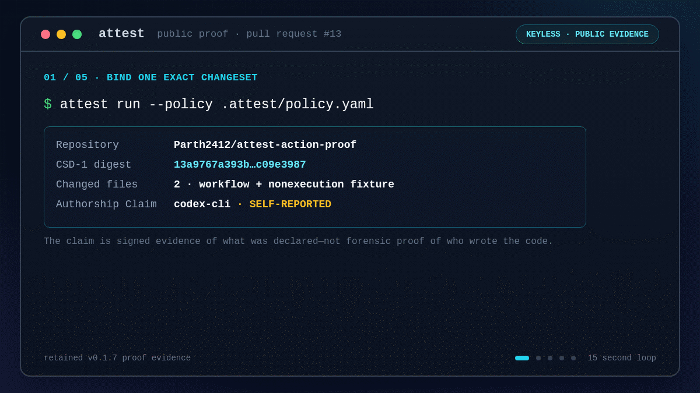

# attest

[](https://github.com/Parth2412/attest/actions/workflows/ci.yml)
[](https://github.com/Parth2412/attest/releases/latest)
[](LICENSE)

attest is an open-source, CI-native provenance toolchain for code changes. It binds declared
AI-authorship claims and forge-sourced Review Records to a deterministic ChangeSet, signs the
result with a CI workload identity, verifies that identity, and evaluates a merge policy.

It answers a deliberately narrow question:

> Which claims and review evidence were present for this exact ChangeSet, and which trusted
> workflow signed that record?



The terminal session follows the public scenario in
[`attest-action-proof#13`](https://github.com/Parth2412/attest-action-proof/pull/13): the same
`CSD-1` ChangeSet verifies in both states, policy denies it with no human approval, and policy
allows it after one effective non-author approval. The
[full terminal walkthrough](docs/assets/attest-linkedin-demo.mp4) shows inspection, cryptographic
verification, and both policy decisions; its editable
[animated SVG](docs/assets/attest-terminal-demo.svg) is available alongside the render.

attest records chain of custody. It does not infer who wrote a line of code, assess code quality,
or decide whether an organisation satisfies a compliance framework.

> **Status:** public `v0.1.7` pre-alpha. F-01 through F-11 are complete and available as six
> Python distributions, multi-platform image `0.1.7`, immutable Action `v1.0.7`, and reviewed
> moving tag `v1`. Evidence export (F-12) remains planned and unpublished pending
> practising-auditor validation (`CH-04`). The external adoption gates for a stable product/v1
> declaration remain open.

## Why attest exists

Git records commits. A forge records pull-request reviews. AI coding tools may emit their own
metadata. These signals are useful, but on their own they do not create one durable record binding:

```text
ChangeSet  <->  Authorship Claims  <->  Review Record  <->  Signing Identity
 what changed      what was declared     what the forge saw     which CI job signed
```

attest turns those inputs into a versioned in-toto Statement, a keyless Sigstore signature, and a
Bundle with transparency-log verification material. A later verifier checks both the cryptography
and the expected workload identity before policy evaluation.

Use attest when you need to:

- preserve declared AI contribution and human-review evidence for an exact code change;
- enforce review and provenance requirements as a required CI check;
- re-verify signed evidence without trusting a mutable dashboard or the original runner; or
- complement build provenance with an authoring-and-review record created before the build.

## Five-minute GitHub setup

Prerequisites: a cloned GitHub repository, Python 3.12 or 3.13, Git 2.40+, and
[`uv`](https://docs.astral.sh/uv/). The repository should have an `origin` remote and
`origin/HEAD` configured.

From the repository root, run the released initializer. Both Actions are pinned to reviewed commit
SHAs; do not replace them with mutable branch names.

```bash
uvx --from attest-cli==0.1.5 attest init \
  --checkout-ref actions/checkout@3d3c42e5aac5ba805825da76410c181273ba90b1 \
  --action-ref Parth2412/attest/action@c42e52d038f5ecdcc498679cb7648e5b0957d489
```

This creates exactly three files and refuses to overwrite an existing target:

```text
.attest/config.yaml
.attest/policy.yaml
.github/workflows/attest.yml
```

Review the generated identity and policy, commit the files, and open a pull request. The default
policy requires one independent human Review Record, so the first run is expected to deny an
unreviewed ChangeSet. After the review is submitted, rerun the job. Once the workflow behaves as
intended, configure the `attest` job as a required status check in the repository's branch
protection.

If repository or default-branch discovery is unavailable, provide both explicitly:

```bash
attest init \
  --github-repository OWNER/REPOSITORY \
  --default-branch main \
  --checkout-ref actions/checkout@3d3c42e5aac5ba805825da76410c181273ba90b1 \
  --action-ref Parth2412/attest/action@c42e52d038f5ecdcc498679cb7648e5b0957d489
```

The generated workflow grants only the permissions required for a publishing `run`: repository
contents, OIDC identity, pull-request records, and check records. Fork pull requests receive no
signing or write authority and fail before repository-controlled content is read. Never replace
this boundary with `pull_request_target`.

## GitHub Action

The initializer is the recommended setup path. The generated Action step is equivalent to:

```yaml
- uses: Parth2412/attest/action@c42e52d038f5ecdcc498679cb7648e5b0957d489
  env:
    GITHUB_TOKEN: ${{ github.token }}
  with:
    mode: run
    policy: .attest/policy.yaml
    push-attestation: "true"
    fail-on-violation: "true"
```

Available modes are closed and intentionally small:

| Mode | Behaviour | Signs | Writes storage |
|---|---|---:|---:|
| `run` | collect -> build -> sign -> store -> verify -> gate | yes | configurable |
| `verify` | verify a supplied Bundle and expected Signing Identity | no | no |
| `gate` | verify a supplied Bundle, then evaluate policy | no | no |

Successful runs expose the ChangeSet Digest, stored Bundle reference, policy Decision, and Rekor
log index. Configuration, signature, identity, storage, and network failures remain fatal even when
policy violations are configured as non-blocking.

The released Action is also available as immutable `v1.0.7` and reviewed moving tag `v1`. For a
reproducible workflow, pin the full release commit shown above. The Action itself consumes the
reviewed multi-platform image only by digest—never by a mutable image tag.

## CLI

Install the released command in an isolated environment:

```bash
uv tool install attest-cli==0.1.5
attest version
attest doctor
```

The CLI exposes the complete pipeline and its individual stages:

```text
init     create config, policy, and a pinned GitHub workflow
collect  collect one exact ChangeSet and its evidence
build    build the canonical in-toto Statement
sign     sign with the ambient keyless Sigstore identity
push     store exact Bundle bytes
verify   verify the Bundle against mandatory identity and issuer constraints
gate     verify, then evaluate policy
run      execute collect through gate in order
inspect  parse without verifying identity or signature
doctor   diagnose local capabilities; network probes are explicit
```

`verify` always requires both identity and issuer constraints. `inspect` is parse-only and reports
an unverified-identity outcome; it must not be used as a security decision. Use `--json` for the
closed machine-readable report schema and stable semantic exit codes:

| Exit | Meaning |
|---:|---|
| `0` | success |
| `1` | unexpected internal failure |
| `2` | usage or configuration failure |
| `3` | policy denied the ChangeSet |
| `4` | verification failed |
| `5` | required attestation was not found |
| `6` | transient network failure; safe to retry |

## What is signed

The normative wire contract is [SPEC-001](spec/SPEC-001.md). At a high level, each Statement binds:

- the deterministic `CSD-1` ChangeSet Digest computed from Git object identities;
- self-reported Authorship Claims collected from supported repository signals;
- a forge-sourced Review Record and relevant check information;
- collection context and the exact subject; and
- the Signing Identity encoded in the Sigstore verification material.

Raw prompts are not stored. Authorship Claims are unverified by nature: the signature establishes
that a claim was present in the signed Statement, not that the claim is forensic truth.

## Storage and policy

attest supports filesystem, Git-ref, and OCI storage backends with a filesystem fallback. The
policy engine evaluates only a successfully verified result and produces an `allow`, `warn`, or
`deny` Decision with stable reason codes.

Cryptographic verification and policy evaluation are separate boundaries:

- verification asks whether the Bundle, subject, transparency-log evidence, and Signing Identity
  are valid;
- policy asks whether that verified evidence satisfies the organisation's declared requirements.

A policy gate affects merging only after a repository administrator makes its check required.

## Release and public evidence

The current immutable source release is
[`v0.1.7`](https://github.com/Parth2412/attest/releases/tag/v0.1.7). It contains the release
contract, checksums, public-package verification, SBOM, SLSA provenance, vulnerability and
component scans, performance evidence, dogfood Bundle, and verification records.

| Distribution | Public version |
|---|---:|
| `attest-core` | `0.1.0` |
| `attest-collect` | `0.1.0` |
| `attest-sign` | `0.1.1` |
| `attest-store` | `0.1.2` |
| `attest-policy` | `0.1.0` |
| `attest-cli` | `0.1.5` |
| `attest-export` | unpublished; F-12 is not complete |

The current Action release points to commit
`c42e52d038f5ecdcc498679cb7648e5b0957d489` and image manifest
`sha256:14e47087c9e6346c8115ba29eb00a922fcc3da630411058f8f35fee7684bf356`.
Immutable release tags cannot be updated or deleted.

Public behaviour is independently inspectable:

- [same-repository proof PR #13](https://github.com/Parth2412/attest-action-proof/pull/13)
  denied the unreviewed ChangeSet, passed after the project owner's review, and merged;
- [fork proof PR #14](https://github.com/Parth2412/attest-action-proof/pull/14) failed before
  receiving signing or write authority; and
- [release `v0.1.7`](https://github.com/Parth2412/attest/releases/tag/v0.1.7) retains the exact
  publication evidence, while [promotion run
  `40287925165`](https://github.com/Parth2412/attest/actions/runs/40287925165) independently
  revalidated the release and both proofs before reviewed `v1` movement.

## Security model and limitations

attest is designed to fail closed, but its trust boundary must remain explicit:

- Undeclared AI use is invisible to the claim model.
- A Review Record establishes that a review event occurred; it does not establish comprehension.
- A compromised trusted CI workflow can sign malicious content with a genuine workload identity.
- A public transparency log can expose repository and workflow metadata.
- The experimental Claude Code and Codex hooks cover only their documented edit events; CH-03
  real-world claim-emission validation remains open.
- Predicate identifiers remain unstable throughout the `v0.x` series.
- Auditor-facing Evidence Bundle export is not shipped; CH-04 must close before F-12 reaches its
  Definition of Done.
- The v1.0.7 hosted cold-start p95 values were 12, 14, and 14 seconds, with a combined p50 of
  11 seconds and p95 of 14 seconds across 60 samples. Every result passed both the engineering
  target below 15 seconds and the release SLO below 18 seconds.

Read the complete [security threat model](docs/12-SECURITY-THREAT-MODEL.md), and report suspected
vulnerabilities privately according to [SECURITY.md](SECURITY.md).

## Specification and project status

- [Master project document](docs/00-MASTER-PROJECT-DOCUMENT.md)
- [Normative terminology and limitations](docs/01-GLOSSARY-AND-CONVENTIONS.md)
- [SPEC-001 and normative test vectors](spec/SPEC-001.md)
- [Architecture decisions](docs/05-ADR-LOG.md)
- [Requirement traceability and feature status](docs/06-BRD-INDEX-AND-TRACEABILITY.md)
- [Current project status](PROJECT_SPECS.md)
- [Open empirical challenges](docs/14-OPEN-CHALLENGES-AND-VALIDATION.md)

## Development

Prerequisites: Python 3.12 or 3.13, Git 2.40+,
[`uv`](https://docs.astral.sh/uv/), and [`just`](https://just.systems/).

```bash
uv sync --locked --all-packages
uv run pre-commit install
just check
```

Read [CONTRIBUTING.md](CONTRIBUTING.md) before changing the code or normative documents.
Experimental claim-emission integrations and their exact limitations are documented under
[examples/hooks](examples/hooks/README.md).

If you are evaluating AI-assisted development controls, try the five-minute setup and share the
result in [GitHub Discussions](https://github.com/Parth2412/attest/discussions). Design partners
can open a private security report for sensitive findings or a public issue for product feedback;
the project does not claim certification or framework compliance.

## Licensing

Code is licensed under Apache-2.0. SPEC-001 and the normative test vectors are licensed under
CC-BY-4.0. See [LICENSE](LICENSE) and [LICENSE.spec](LICENSE.spec).
